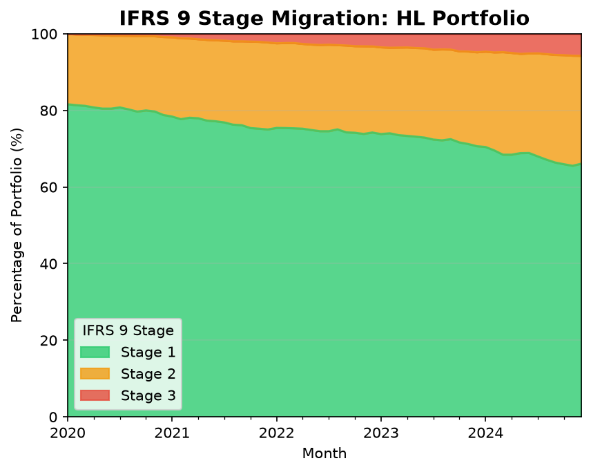
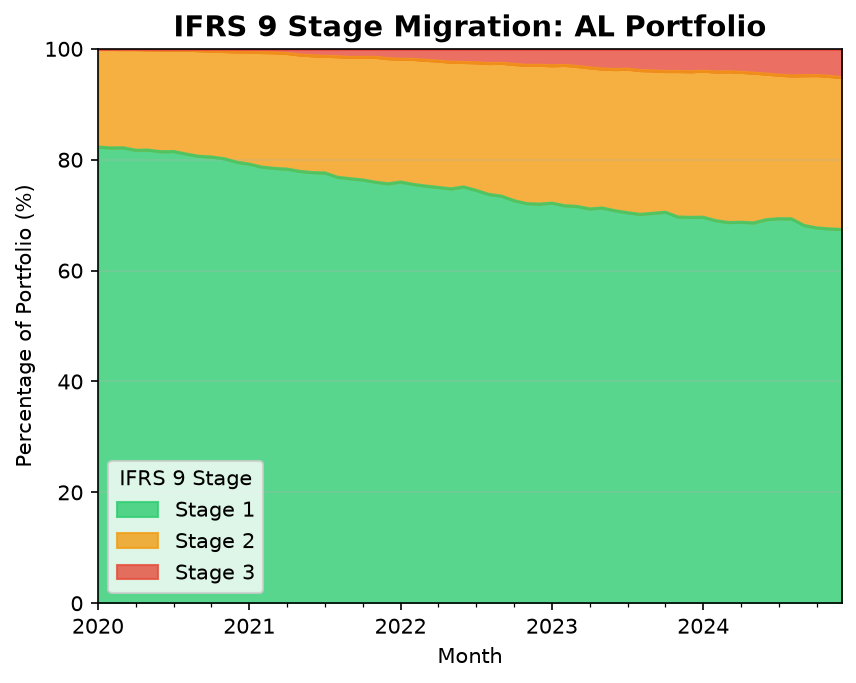
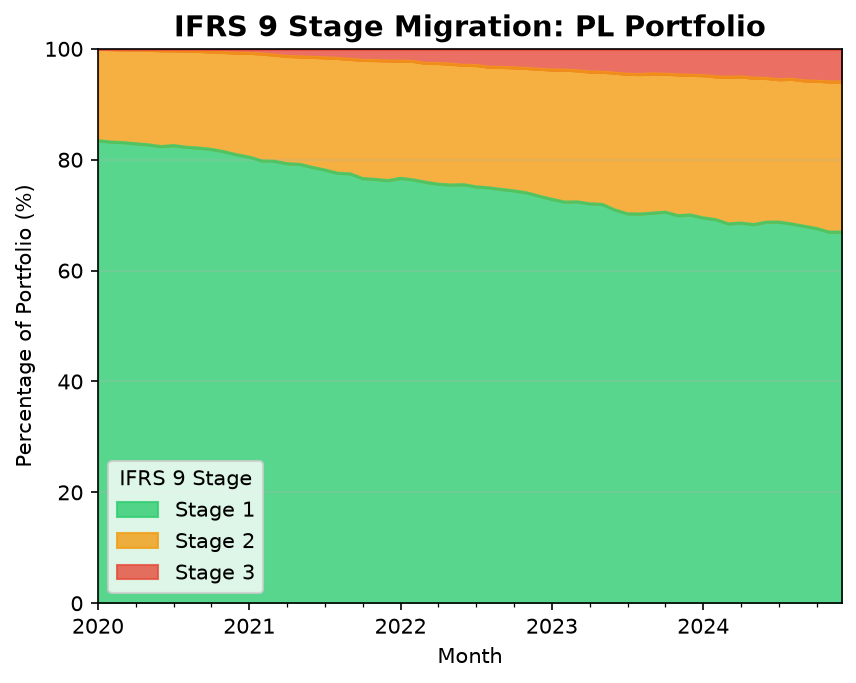
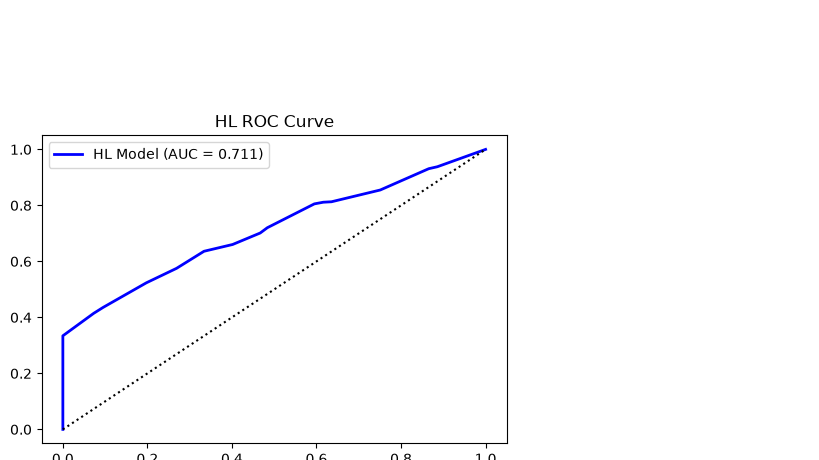
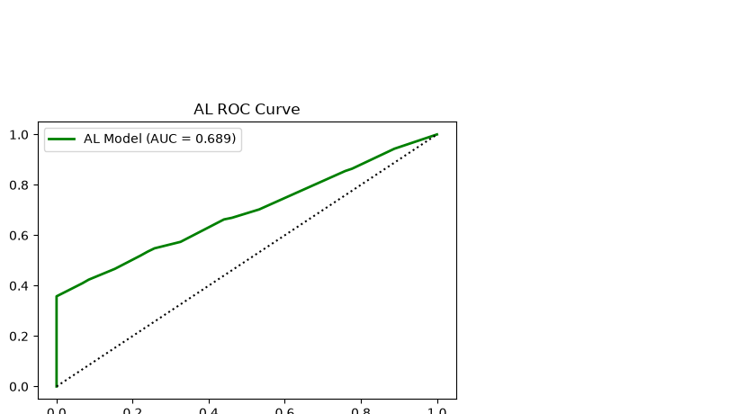
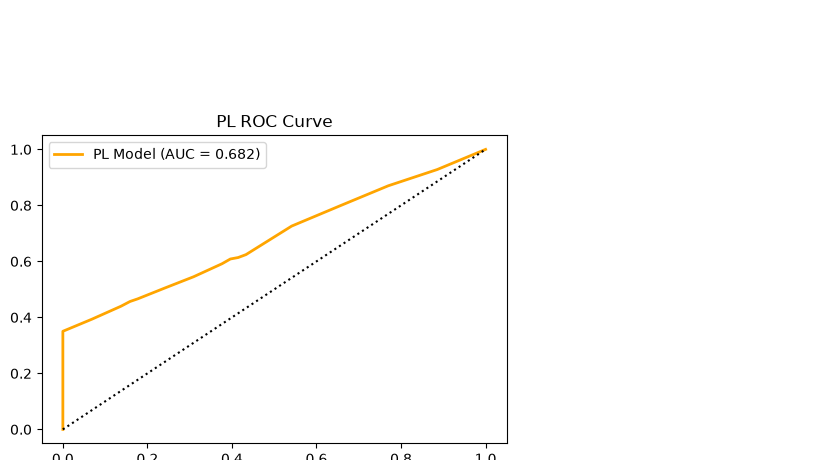
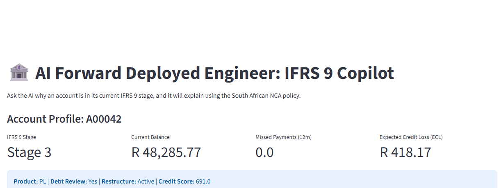
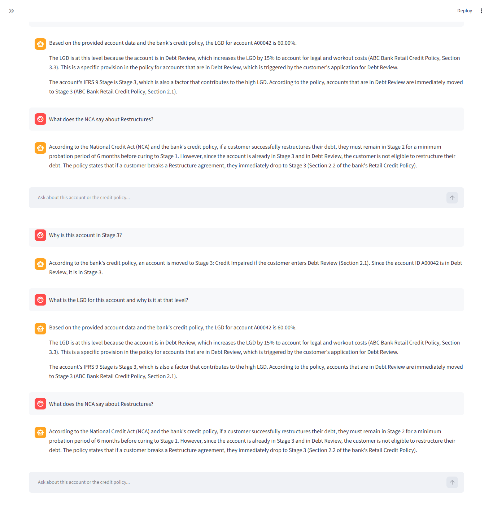

# AI-FDE-Credit-Risk-Copilot

# AI Forward Deployed Engineer: IFRS 9 Credit Risk Copilot

## Overview
This repository demonstrates the transition from a traditional Quantitative Analyst to an **AI Forward Deployed Engineer (FDE)**. It combines a 60-month synthetic South African credit portfolio (SCD), a dynamic IFRS 9 Staging Engine, Product-Specific PD models (HL, AL, PL), and a **Local LLM (Llama 3) RAG Pipeline** to explain credit decisions to business users.

## 1. IFRS 9 Staging Engine (NCA Compliant)
We built a 60-month panel to evaluate dynamic staging. The model incorporates South African National Credit Act (NCA) rules, including Debt Review and Restructures (Forbearance). If a customer breaks a restructure or enters debt review, they automatically trigger Stage 3 (Credit Impaired).

By separating the portfolios, we can clearly see how different asset classes season over time. 

### Home Loans (HL)
Home Loans start with extremely high credit quality and season very slowly due to the long-term nature of the collateral.


### Asset Loans (AL)
Asset Loans (vehicle finance) show moderate seasoning as the vehicles depreciate, increasing the risk profile over the 60 months.


### Personal Loans (PL)
Personal Loans are unsecured and show the fastest migration into Stage 2 and Stage 3, reflecting their higher inherent risk.


## 2. Product-Specific Probability of Default (PD) Models
In retail banking, you cannot run a single model for all products. We built three separate Logistic Regression models using Weight of Evidence (WoE) to capture the unique risk profiles of Home Loans (HL), Asset Loans (AL), and Personal Loans (PL).

### Home Loans (HL)


### Asset Loans (AL)


### Personal Loans (PL)


## 3. AI Forward Deployed Engineering (GenAI / LLM)
To bridge the implementation gap between complex models and business users, we built a **local AI Copilot** using **Ollama (Llama 3)** and **LangChain**. 

The AI uses **Retrieval-Augmented Generation (RAG)** to read the bank's `Credit_Policy.txt` and explain exactly why an account is in Stage 3, citing specific NCA rules and LGD penalties.

### The Account Dashboard
Here is the specific profile of the account selected for the AI to analyze, showing its IFRS 9 Stage, LGD, and Expected Credit Loss (ECL).



*Figure 4: The AI FDE Copilot in action. The user asks why an account is in Stage 3, and the AI accurately cites Section 2.1 (Debt Review) and Section 3.3 (LGD Penalty) of the credit policy.*

## How to Run the Project
1. Clone the repository.
2. Ensure you have Python installed and run `pip install -r requirements.txt`.
3. Download [Ollama](https://ollama.com/) and run:
   - `ollama pull llama3`
   - `ollama pull nomic-embed-text`
4. Run the Streamlit App:
   ```bash
   streamlit run app/ai_fde_app_ollama.py

Author: Raymond Sibanda | Linkedin |
FRM | BSc Mathematics | BCom Honours Accountancy
